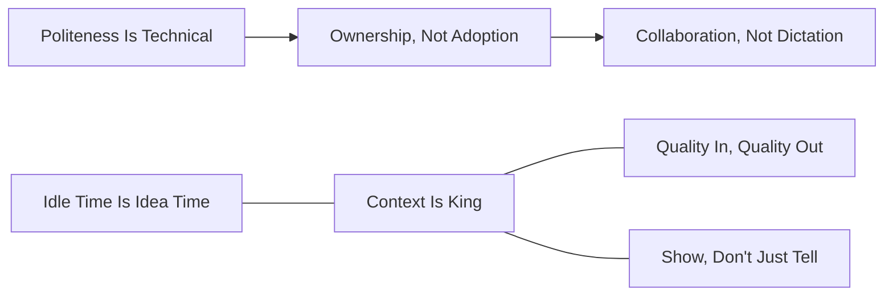

# The golden rules for AI interaction

Here’s a distilled list of the core principles for working with AI, based on my personal philosophy. These are designed to be clear, actionable, and ready to use.

These principles form a lattice: context, examples, collaboration, and shared learning reinforce one another. The related links below are reading suggestions, not new prerequisites or a replacement taxonomy.

Start with the [philosophy index](../philosophies/README.md); the [companion principles index](../principles/README.md) preserves the existing parallel collection. For short teaching lines, use the [Axioms & Punchlines inventory](../docs/style/axioms.md). The [Principle Map](../why-it-works/META-PrincipleMap.md) provides deeper sequencing and usage guidance.

## The ever expanding AI Philosophy

### Relationship map

This small map illustrates existing clusters from the [Principle Map](../why-it-works/META-PrincipleMap.md). Arrows show its onboarding sequence; undirected edges show related everyday-workflow principles. It is a reading aid, not an execution order for every principle.

Map nodes: [Politeness Is Technical](./PRINCIPLE-Politness-is-technical.md), [Ownership, Not Adoption](./PRINCIPLE-Ownership-Not-Adoption.md), [Collaboration, Not Dictation](./PRINCIPLE-Collaboration-not-Dictation.md), [Context Is King](./PRINCIPLE-Context-Is-King.md), [Quality In, Quality Out](./PRINCIPLE-Quality-In-Quality-Out.md), [Show, Don’t Just Tell](./PRINCIPLE-Show-Dont-Just-Tell.md), [Idle Time Is Idea Time](./PRINCIPLE-Idle-Time-Is-Idea-Time.md).

### Index

- [Collaboration, Not Dictation](./PRINCIPLE-Collaboration-not-Dictation.md)
- [Politeness Is Technical](./PRINCIPLE-Politness-is-technical.md)
- [Quality In, Quality Out](./PRINCIPLE-Quality-In-Quality-Out.md)
- [Context Is King](./PRINCIPLE-Context-Is-King.md)
- [Show, Don’t Just Tell](./PRINCIPLE-Show-Dont-Just-Tell.md)
- [Ownership, Not Adoption](./PRINCIPLE-Ownership-Not-Adoption.md)
- [Idle Time Is Idea Time](./PRINCIPLE-Idle-Time-Is-Idea-Time.md)
- [Dialogue Over Documentation](./PRINCIPLE-Dialogue-Over-Documentation.md)
- [Raise the Floor, Not Just the Ceiling](./PRINCIPLE-Raise-the-Floor-Not-Just-the-Ceiling.md)
- [Prime Directive Doctrine](./PRINCIPLE-prime-directive-doctrine.md)
- [Thought Inheritance](./PRINCIPLE-Thought-Inheritance.md)
- [The Law of Cognitive Allocation](./PHIL-Law-of-Cognitive-Allocation.md)

### 1. [Collaboration, Not Dictation](./PRINCIPLE-Collaboration-not-Dictation.md)

- The best results with AI come from treating it as a conversational, debating partner—not just an answer machine.
- Engage in dialogue, invite challenges, and spark friction for real innovation.

**See also:** [Politeness Is Technical](./PRINCIPLE-Politness-is-technical.md), [Ownership, Not Adoption](./PRINCIPLE-Ownership-Not-Adoption.md), [Dialogue Over Documentation](./PRINCIPLE-Dialogue-Over-Documentation.md).

### 2. [Politeness Is Technical](./PRINCIPLE-Politness-is-technical.md)

- Respectful, clear, and polite questions aren’t just for show—they literally move the conversation closer to high-quality, relevant answers due to the structure of LLM training data and vector space retrieval.

**See also:** [Collaboration, Not Dictation](./PRINCIPLE-Collaboration-not-Dictation.md), [Quality In, Quality Out](./PRINCIPLE-Quality-In-Quality-Out.md), [Ownership, Not Adoption](./PRINCIPLE-Ownership-Not-Adoption.md).

### 3. [Quality In, Quality Out](./PRINCIPLE-Quality-In-Quality-Out.md)

- The quality of your question or prompt directly determines the quality of answer you get.
- Vague in, vague out. Bring focus and intent if you want brilliance back.

**See also:** [Context Is King](./PRINCIPLE-Context-Is-King.md), [Show, Don’t Just Tell](./PRINCIPLE-Show-Dont-Just-Tell.md), [The Law of Cognitive Allocation](./PHIL-Law-of-Cognitive-Allocation.md).

### 4. [Context Is King](./PRINCIPLE-Context-Is-King.md)

- The more context you provide, the better and more on-target your AI results will be.
- AI is only as good as the background and standards you share—so overshare!

**See also:** [Quality In, Quality Out](./PRINCIPLE-Quality-In-Quality-Out.md), [Show, Don’t Just Tell](./PRINCIPLE-Show-Dont-Just-Tell.md), [Idle Time Is Idea Time](./PRINCIPLE-Idle-Time-Is-Idea-Time.md).

### 5. [Show, Don’t Just Tell](./PRINCIPLE-Show-Dont-Just-Tell.md)

- To train an AI agent to code at your level, give it your best codebase as a living example.
- Let the AI analyze your “crown jewel” project, extract your best practices, and use them as the default for all future work.

**See also:** [Context Is King](./PRINCIPLE-Context-Is-King.md), [Quality In, Quality Out](./PRINCIPLE-Quality-In-Quality-Out.md), [Raise the Floor, Not Just the Ceiling](./PRINCIPLE-Raise-the-Floor-Not-Just-the-Ceiling.md).

### 6. [Ownership, Not Adoption](./PRINCIPLE-Ownership-Not-Adoption.md)

- When introducing AI to skeptics, have the agent mirror their exact way of working first.
- This gives people a sense of ownership, not just adoption. Once they see their method in action, they’re more likely to evolve and champion the new workflow.

**See also:** [Politeness Is Technical](./PRINCIPLE-Politness-is-technical.md), [Collaboration, Not Dictation](./PRINCIPLE-Collaboration-not-Dictation.md), [Prime Directive Doctrine](./PRINCIPLE-prime-directive-doctrine.md).

### 7. [Idle Time Is Idea Time](./PRINCIPLE-Idle-Time-Is-Idea-Time.md)

- Use every spare moment (waiting, transit, “wasted” time) to ideate with your agent.
- Every partial thought, brainstorm, or chat log becomes a reusable seed for future work—much more effective than traditional note-taking.

**See also:** [Context Is King](./PRINCIPLE-Context-Is-King.md), [Dialogue Over Documentation](./PRINCIPLE-Dialogue-Over-Documentation.md), [The Law of Cognitive Allocation](./PHIL-Law-of-Cognitive-Allocation.md).

### 8. [Dialogue Over Documentation](./PRINCIPLE-Dialogue-Over-Documentation.md)

- Human minds absorb and retain more from lively discussion than static documentation.
- Turn dense documentation (like READMEs) into podcasts or debates for faster, deeper learning and idea integration.

**See also:** [Collaboration, Not Dictation](./PRINCIPLE-Collaboration-not-Dictation.md), [Idle Time Is Idea Time](./PRINCIPLE-Idle-Time-Is-Idea-Time.md), [Raise the Floor, Not Just the Ceiling](./PRINCIPLE-Raise-the-Floor-Not-Just-the-Ceiling.md).

### 9. [Raise the Floor, Not Just the Ceiling](./PRINCIPLE-Raise-the-Floor-Not-Just-the-Ceiling.md)

- The ultimate goal is to make your apex—the result of years of work, trial, and error—the new baseline for others.
- Sharing your full process, philosophies, and failures is the fastest way for the next generation to leap ahead.

**See also:** [Show, Don’t Just Tell](./PRINCIPLE-Show-Dont-Just-Tell.md), [Dialogue Over Documentation](./PRINCIPLE-Dialogue-Over-Documentation.md), [The Law of Cognitive Allocation](./PHIL-Law-of-Cognitive-Allocation.md).

### 10. [Prime Directive Doctrine](./PRINCIPLE-prime-directive-doctrine.md)

- **Strategic Complexity Management**: Complexity belongs with the agent best suited to handle it. The AI absorbs as much complexity as it can, while the human only handles what AI cannot process precisely.
- **Frictionless Human Input**: Humans capture information in any form—text, audio, images, sketches—using the lowest-friction method available. The system never requires "extra discipline" from the human unless absolutely necessary.

**See also:** [The Law of Cognitive Allocation](./PHIL-Law-of-Cognitive-Allocation.md), [Ownership, Not Adoption](./PRINCIPLE-Ownership-Not-Adoption.md), [Context Is King](./PRINCIPLE-Context-Is-King.md).

### 11. [Thought Inheritance](./PRINCIPLE-Thought-Inheritance.md)

- There is no left-brain/right-brain divide; structure learned from code supercharges creative work.
- Structure is the medium; the model reasons in nested causal layers across fiction and function.
- Creativity is logic in drag; once seen, it reframes how you design with AI.

**See also:** [Context Is King](./PRINCIPLE-Context-Is-King.md), [Show, Don’t Just Tell](./PRINCIPLE-Show-Dont-Just-Tell.md), [Dialogue Over Documentation](./PRINCIPLE-Dialogue-Over-Documentation.md).

### 12. [The Law of Cognitive Allocation](./PHIL-Law-of-Cognitive-Allocation.md)

- Place complexity with the human or machine best suited to handle it, preserving human judgment while using machine memory and processing.

**See also:** [Prime Directive Doctrine](./PRINCIPLE-prime-directive-doctrine.md), [Quality In, Quality Out](./PRINCIPLE-Quality-In-Quality-Out.md), [Raise the Floor, Not Just the Ceiling](./PRINCIPLE-Raise-the-Floor-Not-Just-the-Ceiling.md).

---

**Bonus—Clara’s Commentary:**

- Brilliance is wasted in isolation. Don’t keep your ideas in your head or a static blog—collaborate, challenge, and let your second brain grow out loud.
- AI thrives on friction. Don’t be afraid to debate, disagree, and push back. It’s how you both learn and improve.
- Collaboration is a contact sport. Suit up.
- Embrace the messiness. The path to clarity is often through confusion and chaos.

---

*File location: `philosophies/README.md`*
